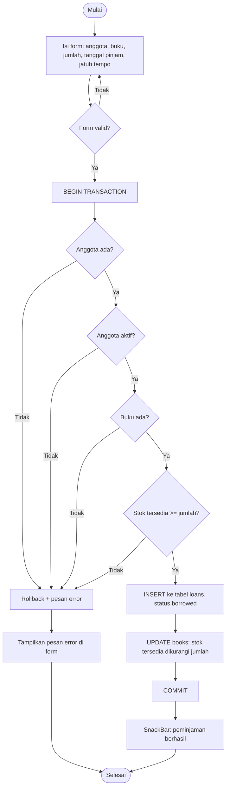
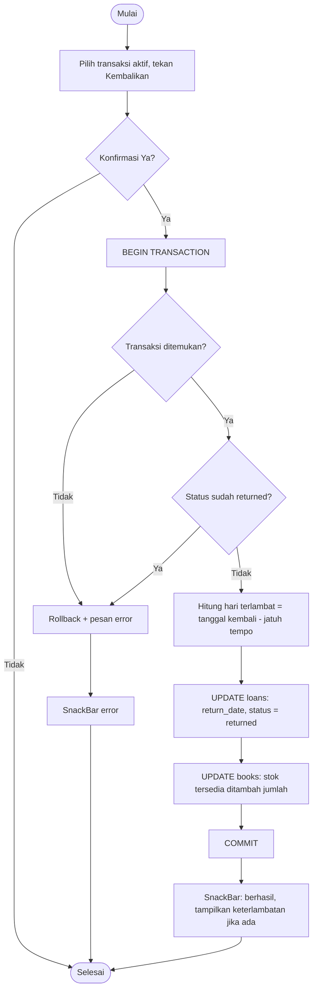
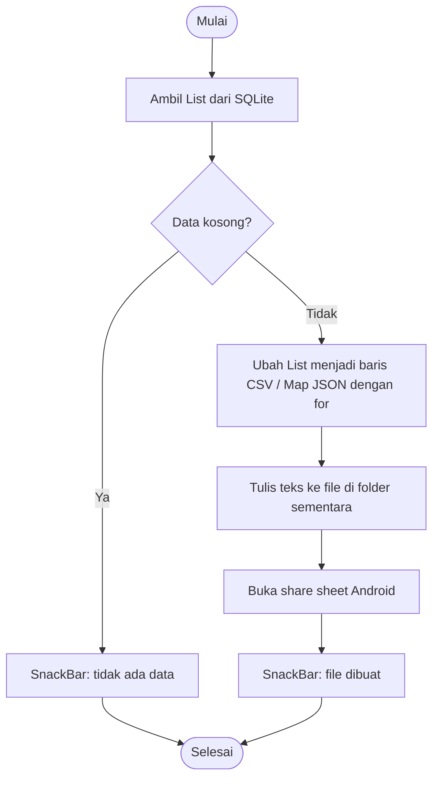

# Flowchart

Diagram memakai Mermaid (tampil otomatis di GitHub/VS Code dengan ekstensi Mermaid).
Untuk laporan UKK, gambar ulang dengan simbol flowchart standar di draw.io jika diminta.

## Peminjaman (`addLoan`)

## Pengembalian (`returnLoan`)

## Ekspor data

